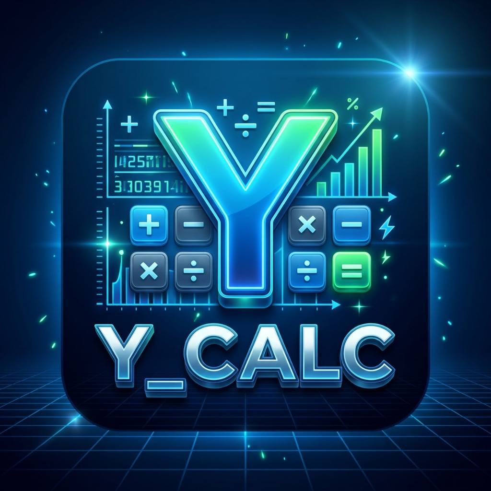

# 🖤 Y Calc — Professional Dark Calculator

<div align="center">



A sleek, professional **dark-themed calculator** built with Flutter.
Designed to look amazing on any Android device.

[](https://play.google.com)
[](https://flutter.dev)
[](https://dart.dev)

</div>

---

## ✨ Features

- 🖤 **Ultra-dark AMOLED theme** — saves battery on OLED screens
- 💜 **Neon purple & cyan gradient accents** — eye-catching design
- ⚡ **Smooth animations** — button press feedback with scale animation
- 📳 **Haptic feedback** — tactile response on every tap
- 🧮 **Full arithmetic** — `+`, `-`, `×`, `÷`
- 🔢 **Decimal support** — accurate floating point math
- 📱 **Adaptive font size** — number display scales automatically
- 📜 **Calculation history** — see your last expression
- 🚫 **Division by zero protection** — graceful error handling
- 🔢 **Percentage calculator** — instant % conversion
- ⌫ **Backspace** — delete last digit
- ±  **Sign toggle** — positive/negative switch

---

## 📸 Screenshots

| Main Screen | Result | Error Handling |
|-------------|--------|----------------|
| Dark minimal UI | Gradient glow | Clean error message |

---

## 🚀 Getting Started

### Prerequisites
- Flutter 3.x SDK
- Android Studio / VS Code
- Android SDK (API 21+)

### Installation

```bash
# 1. Clone the repository
git clone https://github.com/yourusername/y_calc.git
cd y_calc

# 2. Install dependencies
flutter pub get

# 3. Run on device/emulator
flutter run

# 4. Build release APK
flutter build apk --release
```

---

## 🏗️ Project Structure

```
y_calc/
├── lib/
│   ├── main.dart                    # App entry point
│   ├── screens/
│   │   └── calculator_screen.dart   # Main calculator UI
│   ├── widgets/
│   │   ├── calc_button.dart         # Animated button widget
│   │   └── display_panel.dart       # Display with history
│   ├── models/
│   │   └── calculator_model.dart    # Business logic & math
│   └── themes/
│       └── app_theme.dart           # Color palette & theme
├── android/                         # Android platform files
├── assets/
│   └── images/                      # App images
└── pubspec.yaml                     # Dependencies
```

---

## 🎨 Design System

| Element | Color |
|---------|-------|
| Background | `#0A0A0F` (Ultra dark) |
| Secondary BG | `#12121A` |
| Operator buttons | `#9B59FF` (Purple) |
| Equal button | Purple → Cyan gradient |
| Number buttons | `#1E1E2E` |
| Special buttons | `#00D4FF` (Cyan) |
| Display text | `#FFFFFF` |

---

## 🏪 Play Store Ready

This app is configured for Google Play Store:

- ✅ Minimum SDK: **Android 5.0 (API 21)** — covers 99%+ devices
- ✅ Target SDK: **Android 14**
- ✅ 64-bit ARM support
- ✅ Material Design guidelines
- ✅ No unnecessary permissions
- ✅ Clean package name: `com.ycalc.app`

### Build Release APK
```bash
flutter build apk --release
# Output: build/app/outputs/flutter-apk/app-release.apk
```

### Build App Bundle (recommended for Play Store)
```bash
flutter build appbundle --release
# Output: build/app/outputs/bundle/release/app-release.aab
```

---

## 📄 License

MIT License — free to use, modify, and distribute.

---

<div align="center">
Made with ❤️ using Flutter & Dart
</div>
